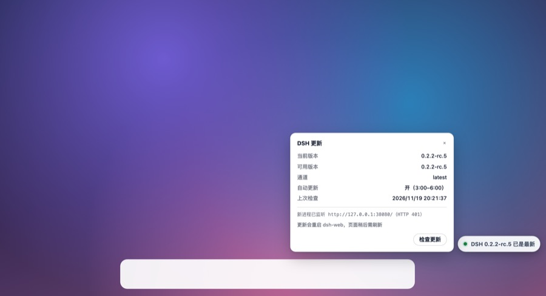

# dsh-web-updater-tab

A DSH Web plugin that puts an update badge in the page: a vertical tab docked to the left or right edge of the window. Hover it to expand, click it for details, and install a new `@deepseek-ai/dsh` release without opening a terminal.

DSH Web has no self-update. The version it runs is the `@deepseek-ai/dsh` pinned in `~/.dsh/profiles/<profile>/package.json`, and the plugin market only updates plugins. This plugin fills that gap: it reads the registry, compares against the version actually running, and drives the same install path a manual upgrade would — with a backup, a verification step, and an automatic rollback.

## Screenshots

| Collapsed (edge tab) | Hover (expanded) |
| --- | --- |
|  |  |

| Details panel | Hidden mode (toast explains how to restore) |
| --- | --- |
|  |  |

## Install

```sh
dsh plugin --profile web add github:z460440448/dsh-web-updater-tab
dsh web          # restart the profile so the plugin mounts
```

The plugin appears as a tab on the right edge of the page. It also registers a section in **Settings → DSH 更新**.

Requirements: DSH Web 0.2.x (tested on `0.2.2-rc.5`). The plugin runs inside the host, so it uses the host's Node.

## What it does

- **Checks** the npm registry for `@deepseek-ai/dsh` (`latest`, `next`, `alpha`), compares it with the installed version, and shows the result on the tab.
- **Updates on click**, in two steps: the button turns into a confirmation, the second click starts the upgrade. The updater then:
  1. backs up `package.json`, `pnpm-lock.yaml`, `pnpm-workspace.yaml`, `cordis.patch.yml`,
  2. adds the new version to `allowBuilds` (pnpm keys those by `name@version`),
  3. runs `pnpm add @deepseek-ai/dsh@<target> --save-exact`,
  4. checks `dsh --version` and `dsh --profile <name> --dump-config`,
  5. stops the old process, starts the new one, and waits for an HTTP answer,
  6. on any failure: restores the backup, reinstalls, and starts the old version again.
- **Schedules automatic updates** — see below. The page alone only reminds; the scheduled task is what installs while you are away.
- **Keeps you informed** through the tab: `可用新版本` (amber), `正在更新` (blue pulse), `已更新，正在刷新`, `更新超时` (red) with a refresh action. After a successful update the page reloads itself (it waits if you are typing).
- **Collapses out of the way**: the tab snaps to the nearer side, drags vertically, remembers `{side, y}`, and hides completely on request — restore it by hovering the screen edge or by opening the page with `?dshUpdater=show`.

## Settings

**Settings → DSH 更新**:

| Control | Effect |
| --- | --- |
| 显示更新挂件 / Show badge | hides the tab entirely (same as the panel's “隐藏挂件”) |
| 自动更新 / Auto-update | writes `autoApply` to the updater config; the scheduled task follows it |
| 自动更新时段 / Window | two hour pickers, cross-midnight allowed (e.g. 22 → 6) |
| 挂件样式 / Style | follow system, light, dark, amber — applies to the tab and the panel |

## Automatic updates

The scheduled half lives in a small CLI that ships with the plugin (`bin/dsh-web-update.mjs`). Register it as a user-level timer once:

```sh
node ~/.dsh/profiles/web/node_modules/dsh-web-updater-tab/bin/dsh-web-update.mjs install
```

That installs a launchd agent (`com.dsh.web-update`) which checks every 6 hours, and inside the configured window — and only when no session has written in the last 15 minutes — applies the update. Without this step the plugin still checks and updates on click; it just won't run while you are away.

Useful commands:

```sh
dsh-web-update check            # what would it do
dsh-web-update apply --yes      # update now (restarts dsh-web)
dsh-web-update status           # config + last result
dsh-web-update rollback --yes   # restore the latest backup
dsh-web-update restart --yes    # restart only, no version change
```

Config: `~/.dsh/web-update/config.json`; state and logs: `~/.dsh/web-update/`.

## Notes and limits

- Only the profile's own `@deepseek-ai/dsh` is updated (which brings `dsh-base`, `dsh-web-app` and the bundled tools with it). Other plugins keep their own update path.
- Plugins whose peer range excludes the new release are skipped by DSH itself; the boot log names them.
- The hidden state is stored per browser (`localStorage`), not per profile.
- Automatic updates restart `dsh-web`. A process started by this plugin is not registered with the Desktop Pet launcher, which may show the harness as stopped until its next action.

## 中文简介

DSH Web 本身没有自更新：它跑的是 profile 里 pin 的 `@deepseek-ai/dsh`，而插件市场只更新插件。这个插件在页面右侧放一个竖直标签，悬停展开、点击查看详情，可以一键把 harness 升到 registry 上的新版本（带备份、校验与失败回滚），也可以在设置里配置自动更新的时段与挂件配色。定时自动更新由随包附带的 CLI 注册的 launchd 任务执行；不注册也能手动更新。

## License

MIT
